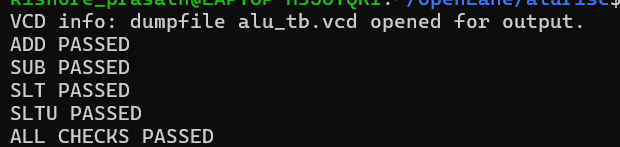

# ALU

## Overview

`alu.sv` is a 32-bit combinational ALU.

| Port | Direction | Width | Description |
|------|-----------|-------|-------------|
| `operand_a` | input | 32 | First operand |
| `operand_b` | input | 32 | Second operand |
| `alu_op` | input | 4 | Selects the operation |
| `result` | output | 32 | Result of the selected operation |
| `zero` | output | 1 | `1` when `result == 0`, otherwise `0` |

## How `alu_op` selects the operation

| `alu_op` | Operation | Description |
|----------|-----------|-------------|
| `0000` | ADD | `a + b` |
| `0001` | SUB | `a - b` (also used by branches; `zero` tells whether the operands were equal) |
| `0010` | AND | Bitwise AND |
| `0011` | OR | Bitwise OR |
| `0100` | XOR | Bitwise XOR |
| `0101` | SLL | Shift left logical by `b[4:0]`, zeros shifted in |
| `0110` | SRL | Shift right logical by `b[4:0]`, zeros shifted in |
| `0111` | SRA | Shift right arithmetic by `b[4:0]`, sign bit copied in |
| `1000` | SLT | `result = 1` if `a < b` treating both as signed, else `0` |
| `1001` | SLTU | `result = 1` if `a < b` treating both as unsigned, else `0` |
| any other value | | `result = 0` |

Notes:

- **Why shifts use only `b[4:0]`:** a 32-bit value can be shifted by 0 to 31 positions, which takes 5 bits. The upper bits of `operand_b` are ignored for shifts.
- **SRL vs SRA:** for `a = 0xF0000000` shifted right by 4, SRL gives `0x0F000000` (zeros shifted in) and SRA gives `0xFF000000` (the sign bit is copied in).
- **SLT vs SLTU:** for `a = 0xFFFFFFFF` and `b = 1`, SLT gives `1` because `-1 < 1` when both are signed. SLTU gives `0` because `4294967295 < 1` is false when both are unsigned.
- **The `zero` flag:** it is `1` whenever the result is all zeros. With SUB, this means the two operands were equal, which is what branch instructions such as BEQ and BNE need.

## Verification / what was tested

The testbench `alu_tb.sv` currently checks only **four** cases:

| Test | Inputs | Expected `result` | Expected `zero` |
|------|--------|-------------------|-----------------|
| ADD | `10 + 20` | `30` | `0` |
| SUB | `2 - 2` | `0` | `1` |
| SLT | `0xFFFFFFFF` vs `1` | `1` (signed, `-1 < 1`) | `0` |
| SLTU | `0xFFFFFFFF` vs `1` | `0` (unsigned) | `1` |

AND, OR, XOR, SLL, SRL and SRA are implemented but **not yet covered** by this testbench. Broader tests (shift edge cases, overflow, all operations) are planned.

The screenshot below shows the terminal output of the run: four `PASSED` lines followed by `ALL CHECKS PASSED`.



## Tools used / how it was simulated

This module was simulated on its own with Icarus Verilog, and the waveform was viewed in GTKWave. The testbench writes `alu_tb.vcd` using `$dumpfile` and `$dumpvars`.

The complete CPU top module will be simulated separately in Vivado once all modules have been tested individually.

Icarus prints `sorry: constant selects in always_* processes are not currently supported`. This is a harmless limitation of the tool and does not affect the result.

## How to run

On Ubuntu:

```
sudo apt install iverilog gtkwave
cd alu
iverilog -g2012 -o alu_sim alu.sv alu_tb.sv
vvp alu_sim
gtkwave alu_tb.vcd
```

If the testbench has no `$dumpfile` lines, no `.vcd` file is produced.

## Next steps

- Extend this testbench to cover all 10 operations.
- Continue with the immediate generator, control unit, register file and the remaining modules.
