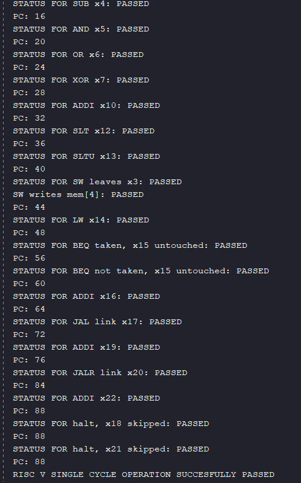
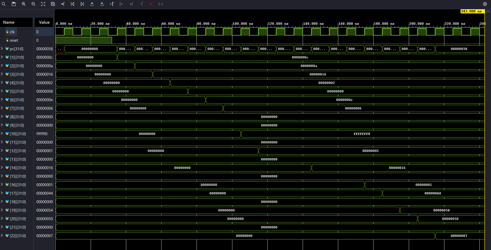

# cpu_top - the full single-cycle CPU

This is the top level of my RV32I single-cycle processor. It connects all the submodules (program counter, instruction memory, control unit, register file, ALU, data memory and write-back mux) and runs a 23-instruction program on them. The testbench checks the PC and the destination register (or memory) after every single instruction.

Simulated in Vivado (xsim), with `cpu_top_tbn` as the simulation top.

## What is in the CPU

| Module | What it does |
|---|---|
| `pc_top` | Holds the PC and picks the next one: PC+4, branch target, JAL target or JALR target |
| `instr_mem` | 256 words of instruction memory. Reads `insmem[pc[9:2]]`, combinationally |
| `imm_gen` | Builds the sign-extended immediate for I, S, B and J instructions |
| `control_unit` | Decodes opcode/funct3/funct7 into the control signals and the ALU operation |
| `register` | 32 x 32-bit register file, two read ports, one write port, x0 always 0 |
| `alu_operand` | Chooses the ALU's second input: `rs2` (R-type, branches) or the immediate |
| `alu` | The arithmetic/logic unit, with a `zero` flag for branches |
| `data_mem` | 256 words of data memory for LW and SW |
| `wbmux` | Chooses what is written back to `rd`: ALU result, memory data, or PC+4 (for JAL/JALR links) |

## Datapath

```
              +-----------------------------------------------+
              |                                               |
              v                                               |
  pc_top --> pc --> instr_mem --> ins1 --+--> control_unit ---+--> control signals
   ^                                      |                    |
   |                                      +--> imm_gen --------+--> immediate
   |                                      |
   |                                      +--> register (rs1, rs2 read)
   |                                                |
   |                          alu_src               v
   |                       immediate --> alu_operand --> alu --> result, zero
   |                                                            |
   |   result (JALR target)                                     v
   +------------------------------------- data_mem (LW / SW) --> mem_data
   |   zero, branch, jump (BEQ / JAL)                           |
   |                                                            v
   +-------------------------------- wbmux (result / mem_data / PC+4) --> rd_data --> register write
```

Everything is combinational inside one clock cycle. Only the PC and the register file (and the SW write into data memory) update on the clock edge.

## How each instruction type uses the datapath

The control unit sets these signals. `alu_op` is 0 (ADD) unless noted.

| Instruction | alu_src | mem_read | mem_write | reg_write | mem_to_reg | branch | jump | jalr | alu_op |
|---|---|---|---|---|---|---|---|---|---|
| R-type (ADD, SUB, AND, OR, XOR, SLL, SRL, SRA, SLT, SLTU) | 0 | 0 | 0 | 1 | 00 (ALU) | 0 | 0 | 0 | from funct3/funct7 |
| ADDI, ANDI, ORI, XORI | 1 | 0 | 0 | 1 | 00 (ALU) | 0 | 0 | 0 | ADD/AND/OR/XOR |
| LW | 1 | 1 | 0 | 1 | 01 (memory) | 0 | 0 | 0 | ADD (address) |
| SW | 1 | 0 | 1 | 0 | n/a | 0 | 0 | 0 | ADD (address) |
| BEQ | 0 | 0 | 0 | 0 | n/a | 1 | 0 | 0 | SUB (zero flag) |
| JAL | n/a | 0 | 0 | 1 | 10 (PC+4) | 0 | 1 | 0 | n/a |
| JALR | 1 | 0 | 0 | 1 | 10 (PC+4) | 0 | 0 | 1 | ADD (rs1 + imm) |

- **LW/SW** use the ALU to compute `rs1 + immediate`, which becomes the memory address.
- **BEQ** subtracts `rs2` from `rs1`. If the result is zero, the `zero` flag is set and the branch is taken. That is why only BEQ works.
- **JAL/JALR** write `PC+4` (the return address) into `rd`. JALR jumps to `rs1 + immediate`, with bit 0 cleared as the RISC-V spec requires.

## How the next PC is chosen

In `pc_top`, in this priority order:

1. `branch && zero` goes to PC + immediate (BEQ taken)
2. `jump` goes to PC + immediate (JAL)
3. `jalr` goes to the ALU result with bit 0 cleared (JALR)
4. otherwise PC + 4

The PC is a byte address. Instructions are 4 bytes, so `instr_mem` is indexed with `pc[9:2]`.

## How the test works

- Before reset ends, the testbench clears all 256 instruction words and all 32 registers, so nothing is X. It then loads the program directly into `instr_mem` using hierarchical references.
- Reset is held for three clock edges and then released.
- `check(name, reg, expected)` waits for the next posedge plus 2 time units, then reads the register file.
- `check_pc(expected)` then reads the PC 2 time units later.
- There is one check pair per instruction, so the checks follow the program step by step. After an instruction executes, the PC already points to the next one, so the expected PC in each pair is the address of the next instruction.
- SW is also checked directly in data memory with an immediate assert, because it is the only instruction that writes there.
- Every failure increments an error counter, and the run ends with a PASS/FAIL summary.

## The test program

| PC | Instruction | What it checks |
|---|---|---|
| 0 | `addi x1,x0,12` | x1 = 12 |
| 4 | `addi x2,x0,10` | x2 = 10 |
| 8 | `add x3,x1,x2` | x3 = 22 |
| 12 | `sub x4,x1,x2` | x4 = 2 |
| 16 | `and x5,x1,x2` | x5 = 8 |
| 20 | `or x6,x1,x2` | x6 = 14 |
| 24 | `xor x7,x1,x2` | x7 = 6 |
| 28 | `addi x10,x0,-16` | x10 = 0xFFFFFFF0 (negative immediate) |
| 32 | `slt x12,x10,x1` | x12 = 1 (signed: -16 < 12) |
| 36 | `sltu x13,x10,x1` | x13 = 0 (unsigned: 0xFFFFFFF0 is larger than 12) |
| 40 | `sw x3,16(x0)` | memory word 4 = 22 |
| 44 | `lw x14,16(x0)` | x14 = 22 (reads back what SW wrote) |
| 48 | `beq x3,x14,+8` | taken, PC jumps from 48 to 56 |
| 52 | `addi x15,x0,99` | skipped, so x15 must stay 0 |
| 56 | `beq x1,x2,+8` | not taken, PC goes to 60 |
| 60 | `addi x16,x0,1` | x16 = 1 |
| 64 | `jal x17,+8` | x17 = 68, PC jumps to 72 |
| 68 | `addi x18,x0,99` | skipped, so x18 must stay 0 |
| 72 | `addi x19,x0,84` | x19 = 84 |
| 76 | `jalr x20,0(x19)` | x20 = 80, PC jumps to 84 |
| 80 | `addi x21,x0,99` | skipped, so x21 must stay 0 |
| 84 | `addi x22,x0,7` | x22 = 7 |
| 88 | `beq x0,x0,0` | halt loop, PC stays at 88 |

In total: 21 register checks, 22 PC checks and 1 data-memory assert.

## Result





Every check passes and the PC ends in the halt loop at 88. In the waveform you can see the registers being written one after another in program order, x17, x19 and x20 get their values after the jumps, and x15, x18 and x21 stay at 0 for the whole run because the instructions that would have set them are skipped.

## What this test proves, and what it does not

**Proved:** the modules work together. Instructions are fetched, decoded and executed correctly. Results land in the right registers, memory is written and read back, BEQ is taken and not taken correctly, and JAL and JALR link and jump correctly.

**Not proved / not supported:**

- This is one fixed program. It runs each instruction type once with one set of values. It is not a random or exhaustive test.
- SLL/SRL/SRA are implemented in the ALU but this program never runs them through the CPU.
- ANDI, ORI and XORI are decoded by the control unit but are not in this program.
- I-type shifts (SLLI, SRLI, SRAI) and SLTI/SLTIU are not decoded by the control unit.
- Only BEQ is implemented. BNE, BLT, BGE, BLTU and BGEU are not supported.
- JALR clears bit 0 of the target as the spec requires. Bit 1 is not checked, so a target that is not a multiple of 4 is not trapped.
- Data memory is 256 words (1 KB) and its address wraps. There are no byte or halfword accesses (LB, LH, SB, SH).
- Unsupported opcodes are simply ignored (no register write, no memory write). There is no exception handling.
- `instr_mem`, `alu_operand` and `wbmux` have no standalone testbenches. They are only covered by this test.
- Simulation only (Vivado xsim). Not synthesised and not tested on an FPGA.

## Where each module lives

| Module | Folder | Tested on its own? |
|---|---|---|
| alu | `alu/` | yes |
| imm_gen | `imm_gen/` | yes |
| register | `register/` | yes |
| control_unit | `control_unit/` | yes |
| data_mem | `data_mem/` | yes |
| pc_top (with programcounter, pc_adder, branch_addr, jump_addr) | `pc_top/` | yes, as one unit |
| instr_mem, alu_operand, wbmux | `cpu_top/rtl/` | no, only through this test |
| cpu_top | `cpu_top/` | this folder |

To simulate in Vivado: add all the RTL files as design sources, add `cpu_top_tbn.sv` as a simulation source, set `cpu_top_tbn` as the simulation top and run all.
