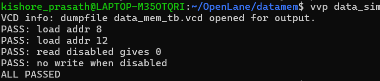
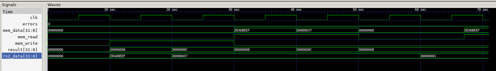

# Data Memory (data_mem)

Part of a single-cycle RISC-V (RV32I subset) CPU written in SystemVerilog.

## What it does

The data memory is where a program keeps its variables. Two instructions use it:

- **LW (load word):** read a 32-bit value from memory into a register.
- **SW (store word):** write a register's 32-bit value into memory.

The address always comes from the ALU (`rs1 + immediate`), so the ALU result is wired to this module.

| Port | Direction | Width | Description |
|---|---|---|---|
| `clk` | input | 1 | clock, writes happen on the rising edge |
| `mem_read` | input | 1 | 1 = read the word at the address (LW) |
| `mem_write` | input | 1 | 1 = write `rs2_data` to the address on the next clock edge (SW) |
| `result` | input | 32 | the address, from the ALU |
| `rs2_data` | input | 32 | the value to store (SW) |
| `mem_data` | output | 32 | the value read from memory (LW) |

The module has no sub-modules.

## How it works

### The storage

```systemverilog
logic [31:0] datamem [0:255];
```

An array of 256 words, each 32 bits wide (1 KB in total).

### Address to word index

The address is in **bytes**, but each memory entry holds a 4-byte word, so the word index is the address divided by 4, which means dropping the lowest two bits:

```systemverilog
datamem[result[9:2]]
```

| Byte address | `result[9:2]` | Word |
|---|---|---|
| 0 | 0 | `datamem[0]` |
| 4 | 1 | `datamem[1]` |
| 8 | 2 | `datamem[2]` |
| 12 | 3 | `datamem[3]` |

Only bits 9 to 2 are used, so addresses wrap around every 1 KB: address 1024 maps to the same word as address 0.

### Reading (combinational)

```systemverilog
always_comb begin
    mem_data = 32'd0;
    if (mem_read == 1'b1) mem_data = datamem[result[9:2]];
end
```

The output follows the address as soon as it changes. With `mem_read = 0`, `mem_data` is 0.

### Writing (clocked)

```systemverilog
always_ff @(posedge clk) begin
    if (mem_write == 1'b1) datamem[result[9:2]] <= rs2_data;
end
```

A write happens only on the **rising clock edge**, and only if `mem_write` is 1. With `mem_write = 0`, the memory keeps its contents.

## Testing

`data_mem_tb.sv` generates a clock, stores values, reads them back, and compares them with the expected values. Each check prints PASS or FAIL, and the run ends with `ALL PASSED` or the number of failures.

### Timing

- The clock period is 10 time units.
- Inputs are changed at the **falling edge**, in the middle of a cycle, so they are stable well before the next rising edge, where the write happens.
- Reads are combinational, so they are checked **2 time units** after the address and `mem_read` are applied.

This avoids a race between changing inputs and the clock edge. An earlier draft of the test raised `mem_read` and checked in the same instant, which read a stale value. A short delay before the check fixed it.

### How the stores work

`mem_write` is held high across two rising edges. The first edge writes `0xDEADBEEF` to address 8. At the next falling edge the address and data change, so the second edge writes 55 to address 12. Then `mem_write` goes low.

### The checks

| Check | What it does | Expected |
|---|---|---|
| load addr 8 | read address 8 after the stores | `0xDEADBEEF` |
| load addr 12 | read address 12 after the stores | 55 |
| read disabled gives 0 | address 8 with `mem_read = 0` | 0 |
| no write when disabled | change `rs2_data` to 1 and let a clock edge pass with `mem_write = 0`, then read address 8 | `0xDEADBEEF` (unchanged) |

The first two checks also show that two stores to different addresses don't overwrite each other.

Result:



Waveform:



**What is not covered yet:** address wraparound at 1 KB, and reads of locations that were never written.

## Tools

Simulated on its own with Icarus Verilog, and the waveform can be viewed in GTKWave (the testbench writes `data_mem_tb.vcd`). The complete CPU is simulated separately once all modules are individually tested.

## Known limitations

- **Word accesses only.** There are no byte or halfword instructions (LB, LH, LBU, LHU, SB, SH).
- **No alignment check.** The low two address bits are ignored, so an unaligned address silently accesses the word that contains it.
- **Address wraparound.** Only address bits 9 to 2 are used, so the memory repeats every 1 KB.
- **Uninitialized contents.** Locations that haven't been written hold unknown values (`X`) in simulation, so a program should store before it loads.
