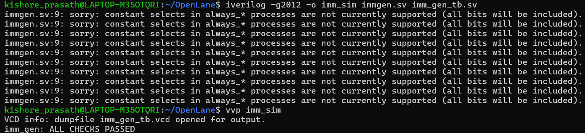

# Immediate Generator (imm_gen)

Part of a single-cycle RISC-V (RV32I subset) CPU written in SystemVerilog.

## What it does

Many RISC-V instructions carry a small constant inside the instruction itself, such as the `5` in `addi x1, x0, 5` or the offset in `beq x1, x2, 8`. This constant is called the **immediate**.

The immediate is stored in different bit positions depending on the instruction type. `imm_gen` collects those bits and produces a clean **32-bit signed value** for the rest of the CPU (ALU, branch adder, jump adder).

| Port | Direction | Width | Description |
|---|---|---|---|
| `ins1` | input | 32 | the full instruction |
| `immediate` | output | 32 | the decoded, sign-extended immediate |

It is purely combinational, with no clock.

## Which instructions it handles

The module looks at the opcode (`ins1[6:0]`) to pick the format:

| Format | Opcodes | Used by | Immediate range |
|---|---|---|---|
| I-type | `0010011`, `0000011`, `1100111` | ADDI/ANDI/ORI/XORI, LW, JALR | -2048 to 2047 |
| S-type | `0100011` | SW | -2048 to 2047 |
| B-type | `1100011` | BEQ and other branches | -4096 to 4094 (even only) |
| J-type | `1101111` | JAL | -1,048,576 to 1,048,574 (even only) |
| anything else | | R-type (ADD, SUB, ...) | output is 0 |

## Where the bits come from

The immediate bits are scattered around the instruction, so each format has its own layout. `imm[n]` means bit n of the immediate.

| Format | Immediate is built from |
|---|---|
| I | `imm[11:0]` = `ins[31:20]` |
| S | `imm[11:5]` = `ins[31:25]`, `imm[4:0]` = `ins[11:7]` |
| B | `imm[12]` = `ins[31]`, `imm[11]` = `ins[7]`, `imm[10:5]` = `ins[30:25]`, `imm[4:1]` = `ins[11:8]`, `imm[0]` = 0 |
| J | `imm[20]` = `ins[31]`, `imm[19:12]` = `ins[19:12]`, `imm[11]` = `ins[20]`, `imm[10:1]` = `ins[30:21]`, `imm[0]` = 0 |

The B and J formats look shuffled because the hardware designers kept the same bit positions across formats where possible, which keeps the decoder simple. The sign bit is always `ins[31]`.

## Sign extension

The immediate in the instruction is only 12, 13 or 21 bits wide, but the CPU works with 32 bits. To widen it without changing its value, the top bit (the sign bit) is **copied** into all the new upper bits. This is called **sign extension**.

In the code this is bit replication, for example for I-type:

```systemverilog
immediate = {{20{ins1[31]}}, ins1[31:20]};
```

`{20{ins1[31]}}` means "repeat bit 31, 20 times".

Examples with a 12-bit immediate:

| 12-bit field | Top bit | Extended to 32 bits | Value |
|---|---|---|---|
| `0x005` | 0 | `0x00000005` | 5 |
| `0x7FF` | 0 | `0x000007FF` | 2047 |
| `0xFFF` | 1 | `0xFFFFFFFF` | -1 |
| `0x800` | 1 | `0xFFFFF800` | -2048 |

Negative numbers use **two's complement**. For example -4 is `0xFFFFFFFC`. Adding it to an address moves backwards by 4, which is how backward branches and jumps work.

### Why bit 0 is always 0 for branches and jumps

Branch and jump offsets are always even, so the instruction does not store bit 0. The hardware inserts a `1'b0` at the bottom (the `, 1'b0}` at the end of the B and J lines).

## "Signed" in the testbench

The module's ports are plain `logic [31:0]` vectors, which are just 32 bits with no sign attached. The sign is only a way of reading those bits.

In the testbench:

- `-32'sd4` means "a 32-bit **s**igned **d**ecimal constant with value -4". It is the same bits as `32'hFFFFFFFC`. The `s` is only there to make the intent clear.
- `$signed(...)` is used in the `$display` message so that a failure prints `-4` and not `4294967292`.
- The comparison itself uses `!==`, which compares the 32 bits one by one. It doesn't matter whether the value was written as signed, unsigned or hex.

## Testing

`imm_gen_tb.sv` applies 10 hand-picked instructions and compares the output with the expected immediate. The instruction encodings were built from the RISC-V field layout, not copied from the module's output, so the test is independent of the design.

| Check | Instruction | Expected | What it tests |
|---|---|---|---|
| ADDI -1 | `0xFFF00093` | -1 | I-type sign extension |
| LW 8 | `0x00812083` | 8 | I-type positive |
| SW -4 | `0xFE20AE23` | -4 | S-type negative, upper and lower halves joined |
| SW 12 | `0x0020A623` | 12 | S-type positive |
| BEQ -8 | `0xFE220CE3` | -8 | B-type negative |
| BEQ 2050 | `0x002201E3` | 2050 | B-type bit `imm[11]` (comes from `ins[7]`) |
| JAL -4 | `0xFFDFF0EF` | -4 | J-type negative |
| JAL 2048 | `0x001000EF` | 2048 | J-type bit `imm[11]` (comes from `ins[20]`) |
| JAL 4096 | `0x000010EF` | 4096 | J-type bit `imm[12]` (comes from `ins[12]`) |
| R-type ADD | `0x002081B3` | 0 | opcode with no immediate gives 0 |

Result:



The screenshot shows the terminal output of the run. The repeated `sorry: constant selects in always_*` lines are a harmless Icarus Verilog limitation, not a bug in the design.

**What is not covered yet:** the extreme values of each range (for example +4094 for branches), and other opcodes in the same format such as JALR with a negative offset.

## Tools

Simulated on its own with Icarus Verilog, and the waveform can be viewed in GTKWave (the testbench writes `imm_gen_tb.vcd`). The complete CPU is simulated separately in Vivado once all modules are individually tested.

## Known limitations

- `LUI` and `AUIPC` (U-type) are not supported, so they return 0. A U-type case (`{ins1[31:12], 12'b0}`) would be needed to add them.
- Branches use the B-type format for all branch instructions, but which branch it is (BEQ, BNE, ...) is decided elsewhere, in the control unit.
