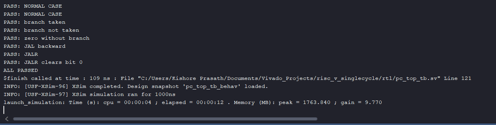
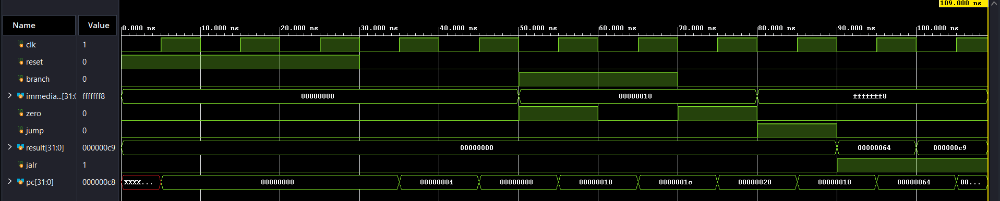

# Program Counter Logic (pc_top)

Part of a single-cycle RISC-V (RV32I subset) CPU written in SystemVerilog.

## What it does

The program counter (PC) holds the **address of the instruction being executed**. `pc_top` has two jobs: store the PC, and decide **what the next PC will be** at every clock edge.

| Port | Direction | Width | Description |
|---|---|---|---|
| `clk` | input | 1 | clock |
| `reset` | input | 1 | sets the PC to 0 at the next clock edge |
| `branch` | input | 1 | the current instruction is a branch |
| `zero` | input | 1 | the ALU result was 0 (for BEQ: the operands are equal) |
| `jump` | input | 1 | the current instruction is JAL |
| `jalr` | input | 1 | the current instruction is JALR |
| `immediate` | input | 32 | the sign-extended offset from `imm_gen` |
| `result` | input | 32 | the ALU result (the JALR target is `rs1 + immediate`) |
| `pc` | output | 32 | the current program counter |

## Structure

`pc_top` is built from four small modules plus a selection block:

```
pc_top
├── programcounter   the register that holds the PC
├── pc_adder         pc + 4
├── branch_addr      pc + immediate (branch target)
├── jump_addr        pc + immediate (JAL target)
└── next-PC selection logic
```

| Module | What it does |
|---|---|
| `programcounter` | A 32-bit register. On every rising clock edge it loads `pc_next`, or 0 if `reset` is high. The reset is **synchronous**: it only takes effect at a clock edge. |
| `pc_adder` | Computes `pc + 4`, the address of the next instruction in normal flow. |
| `branch_addr` | Computes `pc + immediate`, the destination of a branch. |
| `jump_addr` | Computes `pc + immediate`, the destination of JAL. It is the same adder as `branch_addr`, kept separate for clarity. |

`pc_adder` is also used by the write-back mux (`wbmux`), which writes `pc + 4` into the link register for JAL and JALR.

## Why the PC increases by 4

The PC is a **byte address**, and every RV32I instruction is 4 bytes (32 bits) long. Instruction 0 is at address 0, instruction 1 at 4, instruction 2 at 8, and so on. Adding 4 moves to the next instruction. Branch and jump offsets are also in bytes, so `BEQ ... 8` skips one instruction.

## How the next PC is chosen

```systemverilog
branch_taken = branch & zero;

if (branch_taken)  pc_next = branch_target;            // pc + immediate
else if (jump)     pc_next = jump_target;              // pc + immediate
else if (jalr)     pc_next = {result[31:1], 1'b0};     // ALU result, bit 0 cleared
else               pc_next = pcplus4;                  // pc + 4
```

| Case | Condition | Next PC |
|---|---|---|
| Branch taken | `branch = 1` and `zero = 1` | `pc + immediate` |
| JAL | `jump = 1` | `pc + immediate` |
| JALR | `jalr = 1` | `result` with bit 0 cleared |
| Normal | none of the above | `pc + 4` |

### Why JALR clears bit 0

RISC-V defines the JALR target as `rs1 + immediate` with **bit 0 forced to 0**. The immediate can be odd, but instruction addresses never are, so the lowest bit is cleared (201 becomes 200). The testbench has a check for this. It originally failed, which is how the missing bit-0 clearing was found, and it was then fixed.

### Branch and `zero`

A branch is taken only when **both** `branch` and `zero` are 1. A branch with `zero = 0` falls through, and `zero = 1` without `branch` (an ordinary instruction whose result happens to be 0) does nothing.

## Testing

`pc_top_tb.sv` is a self-checking testbench. It runs `pc_top` with all four sub-modules and compares the PC after each clock edge with the expected value.

### Timing

- The clock period is 10 time units.
- Inputs are changed at the **falling edge**, in the middle of a cycle, so they are stable long before the next rising edge.
- The PC is checked **2 time units after the rising edge**, once the register has updated.

This avoids a race between changing inputs and the clock edge.

The first part of the test holds `reset` high for several clock edges and then releases it. The first check (the PC becoming 4) therefore also proves the PC was reset to 0.

### The checks

| Check | Inputs | Expected PC |
|---|---|---|
| NORMAL CASE | after reset | 4 |
| NORMAL CASE | next cycle | 8 |
| branch taken | `branch=1, zero=1, immediate=16` | 24 (8 + 16) |
| branch not taken | `branch=1, zero=0` | 28 (24 + 4) |
| zero without branch | `branch=0, zero=1` | 32 (28 + 4) |
| JAL backward | `jump=1, immediate=-8` | 24 (32 - 8) |
| JALR | `jalr=1, result=100` | 100 |
| JALR clears bit 0 | `jalr=1, result=201` | 200 |

Tcl Console output:



Vivado waveform:



**What is not covered yet:** a branch combined with a jump at the same time (the design gives priority to the branch, but this never happens in real programs), and the reset behavior being checked directly on `pc` before the first rising edge.

## Tools

Simulated in Vivado (behavioral simulation) with `pc_top_tb` as the simulation top. The testbench uses all five RTL files because `pc_top` instantiates the other four. The test output is in the Vivado Tcl Console, and the waveform is from the Vivado waveform window. The complete CPU is simulated separately in Vivado once all modules are individually tested.

## Known limitations

- **Only BEQ is supported.** The branch decision is `branch & zero`, so BNE, BLT, BGE, BLTU and BGEU are not implemented. Adding them would also need changes in the control unit and the ALU compare path.
- **JALR clears bit 0 only.** The target is not forced to a multiple of 4 and no misalignment exception is raised. A target such as 202 is accepted, and the instruction fetch ignores the low two bits of the PC.
- **The `programcounter` reset is synchronous**, so it needs a clock edge to take effect.
