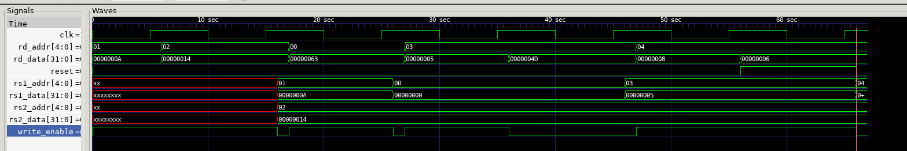

# Register File (register)

Part of a single-cycle RISC-V (RV32I subset) CPU written in SystemVerilog.

## What it does

The register file is the CPU's small, fast storage. RISC-V has **32 registers** (`x0` to `x31`), each **32 bits** wide. Instructions name their operands by register number, for example `add x3, x1, x2` reads `x1` and `x2` and writes the result into `x3`.

This module can **read two registers at the same time** (the two source operands, `rs1` and `rs2`) and **write one register** (the destination, `rd`) on a clock edge.

| Port | Direction | Width | Description |
|---|---|---|---|
| `clk` | input | 1 | clock, writes happen on the rising edge |
| `reset` | input | 1 | blocks writes while high (see "Reset" below) |
| `rs1_addr` | input | 5 | number of the first source register (`ins[19:15]`) |
| `rs2_addr` | input | 5 | number of the second source register (`ins[24:20]`) |
| `rd_addr` | input | 5 | number of the destination register (`ins[11:7]`) |
| `rd_data` | input | 32 | value to write into the destination register |
| `write_enable` | input | 1 | 1 = write `rd_data` into `rd_addr` on the next clock edge |
| `rs1_data` | output | 32 | value read from `rs1_addr` |
| `rs2_data` | output | 32 | value read from `rs2_addr` |

The module has no sub-modules. It is a single file with one memory array and two kinds of logic: a clocked write and two combinational reads.

## How it works

### The storage

```systemverilog
logic [31:0] regfile [31:0];
```

This is an array of 32 words, each 32 bits wide. `regfile[5]` is register `x5`.

### Writing (clocked)

```systemverilog
always_ff @(posedge clk) begin
    if (reset) begin
    end
    else if (write_enable && rd_addr != 5'd0) begin
        regfile[rd_addr] <= rd_data;
    end
end
```

- A write happens only on the **rising clock edge**.
- It happens only if `write_enable` is 1 **and** `rd_addr` is not 0.
- `<=` (non-blocking assignment) is the standard way to write clocked logic, so every flip-flop updates at the same time.
- Instructions that don't produce a result (`SW`, branches) have `write_enable = 0`, so they never change a register.

### Reading (combinational)

```systemverilog
assign rs1_data = (rs1_addr == 5'd0) ? 32'd0 : regfile[rs1_addr];
assign rs2_data = (rs2_addr == 5'd0) ? 32'd0 : regfile[rs2_addr];
```

- Reads don't need a clock. The output follows the address as soon as it changes.
- Both ports read independently, so an instruction can read two registers in the same cycle.

### Register x0 is always zero

In RISC-V, `x0` is hardwired to 0. This design enforces it in two places:

1. **Writes to `x0` are blocked** (`rd_addr != 5'd0`).
2. **Reads of `x0` return 0** (the `? 32'd0 :` part), even though the array entry itself is never written.

This is why `add x0, x1, x2` is a harmless way to throw a result away.

### Reset

When `reset` is high, writes are ignored. The register contents are **not cleared**: the `if (reset)` block is empty. That means every register starts as unknown (`X`) in simulation until a program writes it. This is fine as long as programs write a register before reading it.

### Read and write in the same cycle

If an instruction reads and writes the same register in one cycle, the read returns the **old** value, because the write only takes effect at the clock edge. This is the correct behavior for a single-cycle CPU.

## Testing

`register_tb.sv` generates a clock, applies writes and reads, and compares the results with expected values. It prints only failures, followed by one summary line.

### Avoiding a race condition

The `write` task sets the inputs, waits for the rising edge, and then drops `write_enable` **1 time unit after** the edge:

```systemverilog
@(posedge clk); #1;
write_enable = 0;
```

If the testbench changed its inputs exactly at the clock edge, it would be unclear whether the register file saw the old or the new value. Changing them just after the edge avoids that.

### The checks

| Check | What it does | Expected |
|---|---|---|
| write/read x1 | write 10 to x1, read it back on port 1 | 10 |
| write/read x2 | write 20 to x2, read it back on port 2 | 20 |
| x0 stays 0 | try to write 99 to x0, read x0 | 0 |
| no write when disabled | write 5 to x3, then offer 77 with `write_enable = 0` across a clock edge | 5 |
| write ignored in reset | write 8 to x4, then try to write 6 while `reset = 1` | 8 |

Result:



The screenshot shows the GTKWave waveform of the run.

**What is not covered yet:** every register is not tested (only x1 to x4), and simultaneous reads of the same register on both ports are not checked.

## Tools

Simulated on its own with Icarus Verilog, and the waveform can be viewed in GTKWave (the testbench writes `register_tb.vcd`). The complete CPU is simulated separately in Vivado once all modules are individually tested.

## Known limitations

- `reset` only blocks writes and doesn't clear the registers, so they start as `X`. A loop that sets all 32 entries to 0 inside the `if (reset)` block would give a true reset.
- There is no forwarding or bypass logic. That is not needed in a single-cycle design.
